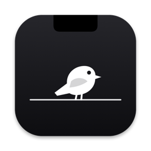
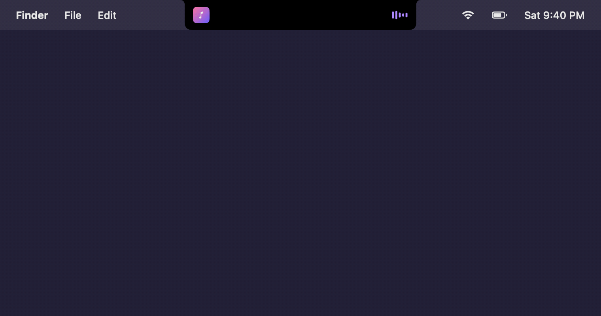
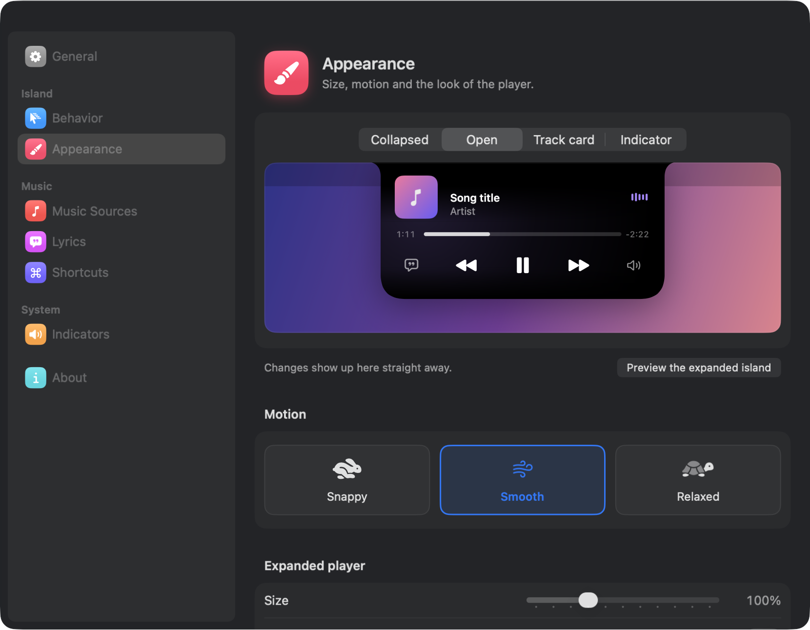

<p align="center">
  
</p>

<h1 align="center">Perch</h1>

<p align="center">
  A music player for the MacBook notch, with lyrics that light up word by word.<br>
  Free and open source. No telemetry. English and Russian interface.
</p>

<p align="center">
  <a href="https://github.com/apathywoke/perch/releases/latest"></a>
  
  <a href="LICENSE"></a>
</p>

<p align="center"><b>English</b> · <a href="README.ru.md">Русский</a></p>

<p align="center">
  
</p>

Artwork and a visualizer sit beside the notch. Hover over it, and the island opens into a full player with a scrubber, controls and lyrics. Music only, nothing else.

## Why Perch

- **Lyrics in the notch.** The current line lights up word by word, as in Apple Music. Perch can even fine-tune the timing by listening to the song, right on your Mac.
- **Music only.** No file shelf, calendar or webcam mirror: one player, done well.
- **Native and light.** Swift and Apple's own frameworks, no third-party code. Almost no CPU use while the island is closed.
- **Private.** No telemetry. Perch goes online for two features only, and both are off until you turn them on.
- **Free.** GPL-3.0, no subscription, no license key.

## Features

- Collapsed island: album artwork and an animated visualizer in the artwork's colour.
- Open player: artwork, title, artist, scrubber, previous / pause / next, and the icon of the app that is playing.
- A brief look at the title when the track changes.
- Volume and brightness indicators in the island instead of the system ones (optional).
- Animated events: Focus turning on and off, charging and low battery, headphones connecting, Caps Lock, the microphone and camera in use. While the microphone or camera is in use, a dot glows on the island, as on iPhone. Events open the island into a large card or stay compact, and each kind can be turned off.
- Swipe sideways with two fingers to change tracks.
- Works with any app macOS shows in Now Playing (Music, Spotify, browsers and so on).
- Screens without a notch: the island appears at the top edge while music plays.
- Global shortcuts, a menu bar icon, launch at login.
- Fallback source: if the system Now Playing stops working, Perch keeps showing Spotify and Music.
- Respects Reduce Motion and works with VoiceOver.
- A welcome window on first launch and a “Copy diagnostics” button for bug reports.
- Settings with a live preview of the island: changes to size, motion and colours show up straight away.
- One-click updates from GitHub, if you want them: update checks are off by default.
- Lyrics in the style of Apple Music: the current line lights up word by word, the text scrolls with the song, and tapping a line jumps to it. When LRCLIB has the timing of every word, the highlight is exact; otherwise word timing is estimated from syllables. Optional, off by default.
- Your own lyrics: for songs LRCLIB lacks, choose an LRC or plain-text file (“Add lyrics…” under the player), or put it in `~/Library/Application Support/Perch/Lyrics` named “Artist - Title.lrc”. Your file replaces LRCLIB and needs no network.
- Timing by ear (experimental, macOS 26+): while lyrics are open, Perch listens to the player, recognises the sung words on your Mac and fits the highlight to them, also fixing lines that LRCLIB marks too early or too late. What it hears is remembered for each song, so from the second listen the timing is right from the start and Perch no longer needs to listen. Works with most languages, English and Russian included. Lyrics without timestamps (your own files and unsynced LRCLIB entries) are synced to the heard words as the song plays. Optionally, a neural network (Spleeter, on your Mac) takes the music out first, so the recogniser catches many more words in heavily produced songs.
- The island hides while the screen is recorded or shared (optional).

## Settings

<p align="center">
  
</p>

| Pane | What you can set |
| --- | --- |
| General | launch at login, menu bar icon, which screen, hiding in full screen, language |
| Behavior | open on hover or click, delays, click action, haptic feedback, new-track card, hiding when paused, gestures |
| Appearance | size, animation speed, glow, shadow, artwork, time format, visualizer and its colour |
| Indicators | volume and brightness: on or off, position, bar colour, number, how long they stay; events: compact or large, which ones to show |
| Music Sources | which apps the island follows, fallback source for Spotify and Music |
| Lyrics | on or off, word-by-word highlight, timing offset, timing by ear, your lyrics folder, amount and size of text |
| Shortcuts | play/pause, next, previous, open the island |
| About | diagnostics, the welcome window again, reset settings |

## Install

Download `Perch-<version>.dmg` from the [latest release](https://github.com/apathywoke/perch/releases/latest), open it and drag Perch to Applications. Requires macOS 14 or later and an Apple silicon Mac.

Perch is not notarized by Apple, so macOS blocks it on first launch: open System Settings → Privacy & Security and click “Open Anyway”. You only need to do this once. A copy you build yourself opens without it.

## Build

You need macOS 14+ and the Xcode Command Line Tools (`xcode-select --install`). Full Xcode is not required.

```bash
./build.sh --run      # build and launch dist/Perch.app
./build.sh --install  # build and install to /Applications
```

The installer (a disk image with an Applications shortcut), after building:

```bash
./Scripts/make-dmg.sh
```

Before committing: unit tests, plus a check that no network code has crept into the app:

```bash
./Scripts/check.sh
```

Every Settings pane in light and dark mode, to check the layout:

```bash
dist/Perch.app/Contents/MacOS/Perch --snapshot-settings ~/Desktop/perch-settings
```

The README images (demo GIF and the Settings window in both languages), into `docs/`. Keep the screen unlocked while it records:

```bash
./Scripts/make-demo.sh
```

### Signing

`build.sh` signs the app with the “Perch Local Signing” certificate from your keychain if there is one (set `PERCH_SIGN_IDENTITY` to use another). With a stable signature macOS remembers the Accessibility permission between builds. Without the certificate the app is signed ad hoc, and the permission has to be granted again after every build. To create the certificate on your Mac:

```bash
./Scripts/make-signing-cert.sh
```

It works only on this Mac, and nothing else trusts it. You can delete it in Keychain Access.

## Privacy and security

- No telemetry, analytics or crash reports.
- Perch goes online for three features only, and all are off until you turn them on:
  - **update checks**: asks GitHub for the latest release;
  - **lyrics**: when you open the lyrics, the song's title, artist, album and length go to lrclib.net. Lyrics are kept in memory only.
  - **voice separation model**: when you turn on “Separate the voice from the music”, the model (about 36 MB) is downloaded once from Perch's GitHub releases and installed only if its SHA-256 matches the one in the code.
- Every request is made by the system `curl` from one file, [`Network.swift`](Sources/Perch/Network.swift), over HTTPS only and only to github.com and lrclib.net. `Scripts/check.sh` makes sure networking appears nowhere else.
- “Hide while the screen is recorded or shared”: the island asks recording apps not to capture it, and disappears completely while recording, because ScreenCaptureKit on macOS 15.4+ ignores that request. Perch learns about recording through the private function `SLSIsScreenWatcherPresent`. Screenshots (⌘⇧3) may still include the island.
- An update is installed only if the new app is signed the same way as the installed one (same certificate). An ad hoc signed copy can't be updated in place; download the new version by hand.
- Perch never asks for Screen Recording or the microphone. The visualizer is decorative and doesn't analyse sound.
- “Time words by ear” (off by default): while lyrics are open, Perch takes the sound of the player app only, through a private Core Audio tap, and passes it to the macOS speech recognizer, which runs on your Mac. The sound is not recorded and goes nowhere. Only the recognised words and their timing are kept, in `~/Library/Application Support/Perch/Heard`, in files named by a hash of the song. “Forget what was heard…” erases them. macOS asks for permission to record system audio and shows the recording indicator while Perch listens. macOS may download the speech model from Apple once. With “Separate the voice from the music” on, the sound first goes through a neural network (Spleeter 2stems by Deezer, MIT licence) on your Mac, only while Perch listens; it is kept in `~/Library/Application Support/Perch/Models` and “Delete…” removes it.
- Accessibility is needed only for the optional volume and brightness indicators: to keep the system indicator from appearing, Perch intercepts those keys and changes the value itself. The tap listens only to the system's media-key events; ordinary key presses never reach it. Volume is changed through CoreAudio, brightness through the private `DisplayServices` (there is no public API).
- Island events need no new permissions. Perch reads Focus from the menu bar through the same Accessibility permission: macOS has no public way to learn when it changes. Caps Lock comes from the modifier-key state (Perch doesn't see which keys are pressed). Charging comes from IOKit, headphones from changes of the audio output device. The microphone and camera come from the “device is running somewhere” flags in CoreAudio and CoreMediaIO: Perch opens, hears and sees nothing.
- macOS asks for permission to control Spotify or Music (AppleScript) in two cases: when the fallback source is in use and you press a player button, and when lyrics are open for a Spotify song. In the second case Perch asks Spotify every two seconds for the position and track name only: what Spotify reports to the system drifts from the real position by half a second after a track change, sometimes by several seconds.
- Diagnostics are collected only when you press the button, go only to the clipboard and contain no track names. Perch's log lives in the macOS system log and contains no track names either.
- No third-party dependencies: Apple's system frameworks only.
- Settings are stored locally in `UserDefaults` (`dev.perch.Perch`).

### How Perch knows what is playing

macOS has no public API for reading Now Playing from other apps, and since macOS 15.4 the private MediaRemote framework answers only processes signed by Apple. So Perch starts the system `/usr/bin/perl`, which loads a small library, [`Helper/PerchMediaHelper.m`](Helper/PerchMediaHelper.m) (about 200 lines). It reads the track data and passes it to the app over stdout, and takes commands over stdin. The process starts with an empty environment and exits with the app.

These are private Apple APIs, so:

- the app can't be published on the Mac App Store or sandboxed;
- a macOS update may break reading the track data. Perch then switches to the fallback source: Spotify and Music announce what they are playing themselves. Music playing in a browser won't show in that case.

“Hide in full-screen apps” uses the private function `CGSCopyManagedDisplaySpaces` only to read the type of the current desktop.

## Project layout

```
Sources/PerchCore/                logic without UI, covered by tests
  Track.swift                     track, position, fixing the position while paused
  NowPlaying.swift                parsing data from the helper and from Spotify / Music, choosing the source
  Layout.swift                    notch and island sizes
  Formatting.swift                time format, volume step
  Activities.swift                when to show battery events, how Focus modes look
  Lyrics.swift                    LRC format, current line, LRCLIB requests
  WordAlignment.swift             matching lyrics to heard words
  UntimedLyrics.swift             timing lyrics without timestamps by ear, parsing your own files
  SpectralSeparator.swift         voice separation: spectrogram in, mask, voice out
  Version.swift                   comparing versions for updates
Sources/Perch/                    the app
  main.swift, AppDelegate.swift   launch, menu bar, Settings and welcome windows
  NotchController.swift           island window, hover, gestures, full screen
  IslandView.swift                island and player UI
  Motion.swift                    every animation and Reduce Motion
  MediaService.swift              track data and player commands
  SpotifyClock.swift              checking the position with Spotify while lyrics are open
  FallbackPlayers.swift           fallback source for Spotify and Music
  SystemHUD.swift                 volume and brightness indicators
  Activities.swift, EventView.swift   island events: sources and animations
  Hotkeys.swift                   global shortcuts
  Preferences.swift               every setting and its default
  SettingsView.swift              Settings window
  Onboarding.swift                welcome window
  Diagnostics.swift               report for bug reports
  AudioOutputs.swift              choosing the audio output device
  Snapshots.swift                 snapshots of Settings and the README demo
  Updater.swift                   checking for and installing updates from GitHub
  Network.swift                   the only place Perch goes online
  LyricsService.swift, LyricsView.swift   lyrics from LRCLIB and your own files
  UserLyricsStore.swift           your lyrics folder, choosing a file
  SongListener.swift              timing by ear: audio tap, recognition, storage
  VocalSeparator.swift            voice separation: the model's download and the network
Tests/PerchCoreTests/             unit tests (Swift Testing)
Helper/                           bridge to Now Playing (Objective-C + Perl)
Resources/                        Info.plist, en / ru localizations
Scripts/                          checks, signing certificate, icon, README demo, voice model conversion
docs/                             README images
```

## License

Perch is free software: you can use, change and share it under the [GNU General Public License version 3](LICENSE). Programs built on Perch's code must also be released as open source under GPL-3.0.
