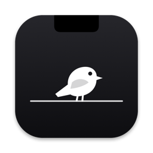
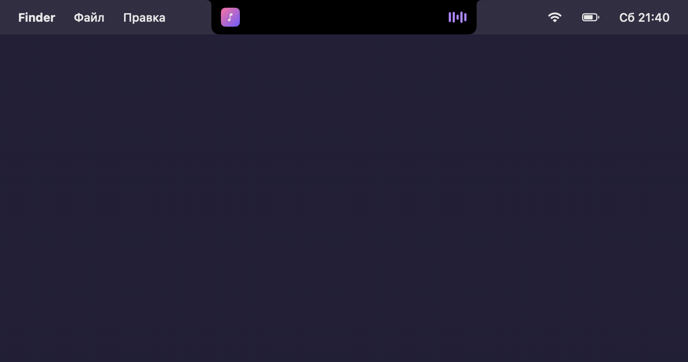
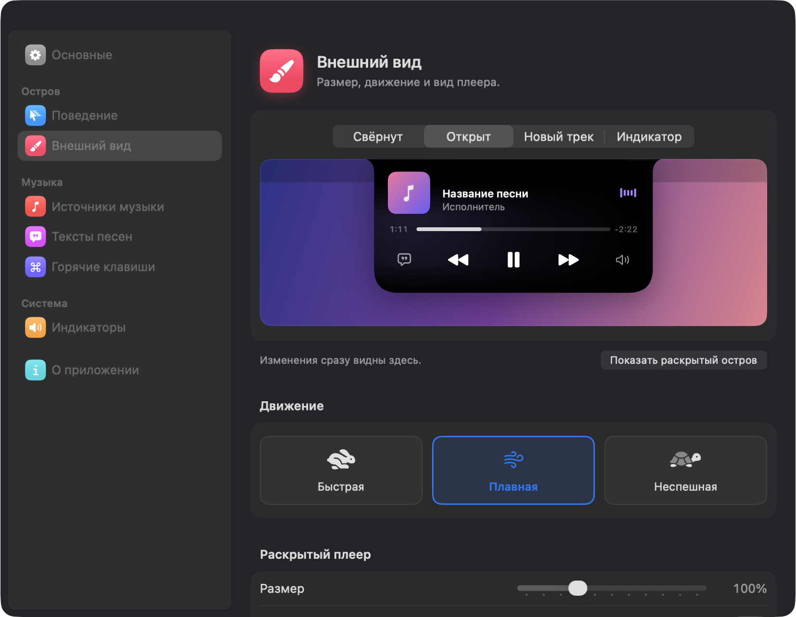

<p align="center">
  
</p>

<h1 align="center">Perch</h1>

<p align="center">
  Музыкальный плеер для выреза MacBook с текстом песни, который подсвечивается по словам.<br>
  Бесплатный, с открытым кодом, без телеметрии. Интерфейс на русском и английском.
</p>

<p align="center">
  <a href="https://github.com/apathywoke/perch/releases/latest"></a>
  
  <a href="LICENSE"></a>
</p>

<p align="center"><a href="README.md">English</a> · <b>Русский</b></p>

<p align="center">
  
</p>

Обложка и визуализатор по бокам от выреза, а по наведению — полноценный плеер с перемоткой, управлением и текстом песни. Только музыка, ничего лишнего.

## Почему Perch

- **Текст песни прямо в вырезе.** Текущая строка подсвечивается по словам, как в Apple Music. Тайминг Perch может уточнить по звуку, прямо на Mac.
- **Только музыка.** Ни полки для файлов, ни календаря, ни зеркала с камерой: один плеер, сделанный хорошо.
- **Родной и лёгкий.** Swift и системные фреймворки Apple, без чужого кода. Пока остров закрыт, процессор почти не нагружается.
- **Приватный.** Никакой телеметрии. В сеть Perch ходит только для двух функций, и обе выключены, пока вы их не включите.
- **Свободный.** GPL-3.0, без подписок и ключей.

## Возможности

- Свёрнутый остров: обложка и анимированный визуализатор в цвет обложки.
- Раскрытый плеер: обложка, название, исполнитель, перемотка, предыдущий / пауза / следующий, значок приложения-источника.
- Короткий показ названия при смене трека.
- Индикаторы громкости и яркости в острове вместо системных (по желанию).
- События с анимацией: включение и выключение Фокуса, зарядка и низкий заряд, подключение наушников, Caps Lock, использование микрофона и камеры. Пока используется микрофон или камера, на острове горит точка, как на iPhone. События раскрывают остров в крупную карточку или остаются компактными, каждый вид можно выключить.
- Смахивание двумя пальцами вбок переключает трек.
- Работает с любым приложением, которое macOS показывает в «Исполняется» (Музыка, Spotify, браузеры и т. д.).
- Экраны без выреза: остров появляется у верхнего края, пока играет музыка.
- Глобальные горячие клавиши, значок в строке меню, автозапуск.
- Запасной источник: если системное «Исполняется» перестанет работать, Perch продолжит показывать Spotify и «Музыку».
- Учитывает «Уменьшение движения» и работает с VoiceOver.
- Окно знакомства при первом запуске и кнопка «Скопировать диагностику» для сообщений об ошибках.
- Настройки с живым предпросмотром острова: изменения размера, анимации и цветов видны сразу.
- Обновления с GitHub в один клик — по желанию, проверка выключена по умолчанию.
- Тексты песен в стиле Apple Music: текущая строка подсвечивается по словам, текст прокручивается вместе с песней, по строке можно перейти. Если в LRCLIB есть время каждого слова, подсветка точная, иначе время слов оценивается по слогам. По желанию, выключены по умолчанию.
- Свои тексты: для песен, которых нет в LRCLIB, можно выбрать файл LRC или обычный текст («Добавить текст…» под плеером) или положить его в папку `~/Library/Application Support/Perch/Lyrics` под именем «Артист - Название.lrc». Свой файл заменяет LRCLIB и к сети не обращается.
- Уточнение тайминга по звуку (эксперимент, macOS 26+): Пока открыт текст, Perch слушает плеер, распознаёт спетые слова прямо на Mac и подгоняет под них подсветку, а заодно исправляет строки, размеченные в LRCLIB слишком рано или поздно. Услышанное запоминается для каждой песни, так что со второго прослушивания тайминг точен с начала, а слушать заново уже не нужно. Работает с большинством языков, включая русский и английский. Тексты без таймкодов (свои файлы и записи LRCLIB без синхронизации) синхронизируются по услышанным словам прямо во время прослушивания. По желанию нейросеть (Spleeter, прямо на Mac) сначала убирает музыку, и в песнях с плотным сведением распознаётся намного больше слов.
- Скрытие острова при записи и демонстрации экрана — по желанию.

## Настройки

<p align="center">
  
</p>

| Раздел | Что настраивается |
| --- | --- |
| Основные | автозапуск, значок в строке меню, выбор экрана, скрытие в полноэкранном режиме, язык |
| Поведение | раскрытие по наведению или клику, задержки, действие по клику, тактильный отклик, показ нового трека, скрытие на паузе, жесты |
| Внешний вид | размер, скорость анимации, свечение, тень, альбом, формат времени, визуализатор и его цвет |
| Индикаторы | громкость и яркость: включение, расположение, цвет полосы, число, время показа; события: компактно или крупно, какие показывать |
| Источники музыки | какие приложения показывать в острове, запасной источник для Spotify и «Музыки» |
| Тексты песен | включение, подсветка по словам, сдвиг тайминга, уточнение по звуку, папка своих текстов, объём и размер текста |
| Горячие клавиши | пауза, следующий, предыдущий, раскрыть остров |
| О приложении | диагностика, повторный показ знакомства, сброс настроек |

## Установка

Скачайте `Perch-<версия>.dmg` со страницы [релизов](https://github.com/apathywoke/perch/releases/latest), откройте его и перетащите Perch в «Программы». Требуется macOS 14 или новее и Mac на Apple Silicon.

Perch не нотаризован в Apple, поэтому при первом запуске macOS его заблокирует: откройте «Системные настройки» → «Конфиденциальность и безопасность» и нажмите «Всё равно открыть». Это нужно сделать один раз. Собранный самостоятельно Perch запускается без этого.

## Сборка

Нужны macOS 14+ и Xcode Command Line Tools (`xcode-select --install`). Полный Xcode не требуется.

```bash
./build.sh --run      # собрать и запустить dist/Perch.app
./build.sh --install  # собрать и установить в /Applications
```

Установщик (образ диска с ярлыком «Программы») после сборки:

```bash
./Scripts/make-dmg.sh
```

Проверка перед коммитом — модульные тесты и проверка, что в приложении нет сетевого кода:

```bash
./Scripts/check.sh
```

Снимки всех разделов настроек в светлой и тёмной теме — для проверки вёрстки:

```bash
dist/Perch.app/Contents/MacOS/Perch --snapshot-settings ~/Desktop/perch-settings
```

Картинки для README (демо-GIF и окно настроек на двух языках) в папку `docs/`. Экран во время записи должен быть разблокирован:

```bash
./Scripts/make-demo.sh
```

### Подпись

`build.sh` подписывает приложение сертификатом «Perch Local Signing» из связки ключей, если он есть (другой можно указать в `PERCH_SIGN_IDENTITY`). Со стабильной подписью macOS помнит разрешение «Универсальный доступ» между сборками. Без сертификата приложение подписывается ad hoc, и разрешение придётся выдавать заново после каждой сборки. Создать такой сертификат на своём Mac:

```bash
./Scripts/make-signing-cert.sh
```

Он действует только на этом Mac, и больше ему никто не доверяет. Удалить его можно в «Связке ключей».

## Конфиденциальность и безопасность

- Нет телеметрии, аналитики и отчётов о сбоях.
- В сеть Perch ходит только для трёх функций, и все выключены, пока вы их не включите:
  - **проверка обновлений** — запрос последнего релиза на GitHub;
  - **тексты песен** — когда вы открываете текст, на lrclib.net уходят название песни, исполнитель, альбом и длительность. Тексты хранятся только в памяти.
  - **модель отделения голоса** — когда вы включаете «Отделять голос от музыки», модель (около 36 МБ) один раз скачивается из релизов Perch на GitHub и ставится, только если её SHA-256 совпадает с записанным в коде.
- Все запросы делает системный `curl` из одного файла, [`Network.swift`](Sources/Perch/Network.swift), только по HTTPS и только к github.com и lrclib.net. `Scripts/check.sh` следит, чтобы сеть больше нигде не появилась.
- «Скрывать при записи и демонстрации экрана»: остров просит программы записи не захватывать его, а на время записи исчезает совсем, потому что ScreenCaptureKit в macOS 15.4+ такую просьбу не выполняет. О записи Perch узнаёт через закрытую функцию `SLSIsScreenWatcherPresent`. Снимки экрана (⌘⇧3) остров могут не скрывать.
- Обновление устанавливается, только если подпись нового приложения совпадает с подписью установленного (тот же сертификат). Копию с подписью ad hoc обновить на месте нельзя — новая версия скачивается вручную.
- Не запрашивает запись экрана и микрофон. Визуализатор декоративный и звук не анализирует.
- «Уточнять тайминг по звуку» (выключено по умолчанию): пока открыт текст песни, Perch через частный аудиотап Core Audio получает звук только приложения-плеера и передаёт его системному распознавателю речи macOS, который работает на самом Mac. Звук не записывается и никуда не отправляется. Сохраняются только распознанные слова и их время — в `~/Library/Application Support/Perch/Heard`, файлы названы хешем песни. Стереть их можно кнопкой «Забыть услышанное…». macOS спрашивает разрешение на запись системного звука и показывает значок записи, пока Perch слушает. Языковую модель macOS может один раз скачать с серверов Apple. С включённым «Отделять голос от музыки» звук сначала проходит через нейросеть (Spleeter 2stems от Deezer, лицензия MIT) на самом Mac и только пока Perch слушает; модель лежит в `~/Library/Application Support/Perch/Models`, кнопка «Удалить…» её стирает.
- «Универсальный доступ» нужен только для необязательных индикаторов громкости и яркости: чтобы системный индикатор не появлялся, Perch перехватывает нажатия этих клавиш и меняет значение сам. Перехват зарегистрирован только на системные события медиа-клавиш, обычные нажатия клавиатуры в него не попадают. Громкость меняется через CoreAudio, яркость — через закрытый `DisplayServices` (публичного API нет).
- События острова не требуют новых разрешений. Фокус Perch читает из строки меню через тот же «Универсальный доступ»: у macOS нет открытого способа узнать о его переключении. Caps Lock — по состоянию клавиш-модификаторов (какие клавиши нажимаются, Perch не видит). Зарядка — через IOKit, наушники — по смене устройства вывода звука. Микрофон и камера — по признакам «устройство где-то используется» в CoreAudio и CoreMediaIO: Perch ничего не открывает, не слышит и не видит.
- Доступ к управлению Spotify или «Музыкой» (AppleScript) macOS запрашивает в двух случаях: когда работает запасной источник и вы нажимаете кнопку плеера, и когда открыт текст песни из Spotify. Во втором случае Perch раз в две секунды спрашивает у Spotify только позицию и название трека: то, что Spotify сообщает системе, после переключения трека расходится с реальной позицией на полсекунды, а иногда на несколько секунд.
- Диагностика собирается только по кнопке, попадает только в буфер обмена и не содержит названий треков. Журнал Perch хранится в системном журнале macOS и названий треков тоже не содержит.
- Нет сторонних зависимостей: только системные фреймворки Apple.
- Настройки хранятся локально в `UserDefaults` (`dev.perch.Perch`).

### Как Perch узнаёт, что играет

У macOS нет публичного API для чтения «Исполняется» из чужих приложений, а с macOS 15.4 закрытый фреймворк MediaRemote отвечает только процессам, подписанным Apple. Поэтому Perch запускает системный `/usr/bin/perl`, который загружает небольшую библиотеку [`Helper/PerchMediaHelper.m`](Helper/PerchMediaHelper.m) (около 200 строк). Она читает данные о треке и передаёт их приложению через stdout, а команды получает через stdin. Процесс запускается с пустым окружением и завершается вместе с приложением.

Это закрытые API Apple, поэтому:

- приложение нельзя опубликовать в Mac App Store и нельзя поместить в песочницу;
- обновление macOS может сломать получение данных. Тогда Perch переключится на запасной источник: Spotify и «Музыка» сами рассылают уведомления о том, что играет. Музыку в браузере в этом случае видно не будет.

Режим «скрывать в полноэкранных приложениях» использует закрытую функцию `CGSCopyManagedDisplaySpaces` только для чтения типа текущего рабочего стола.

## Структура

```
Sources/PerchCore/                логика без интерфейса, покрыта тестами
  Track.swift                     трек, расчёт позиции, исправление позиции на паузе
  NowPlaying.swift                разбор данных от помощника и от Spotify / «Музыки», выбор источника
  Layout.swift                    размеры выреза и острова
  Formatting.swift                формат времени, шаг громкости
  Activities.swift                когда показывать события о батарее, вид режимов Фокуса
  Lyrics.swift                    формат LRC, текущая строка, запросы к LRCLIB
  WordAlignment.swift             сопоставление текста песни с услышанными словами
  UntimedLyrics.swift             тайминг текстов без таймкодов по звуку, разбор своих файлов
  SpectralSeparator.swift         отделение голоса: спектрограмма, маска, голос
  Version.swift                   сравнение версий для обновлений
Sources/Perch/                    приложение
  main.swift, AppDelegate.swift   запуск, строка меню, окна настроек и знакомства
  NotchController.swift           окно острова, наведение, жесты, полноэкранный режим
  IslandView.swift                интерфейс острова и плеера
  Motion.swift                    все анимации и «Уменьшение движения»
  MediaService.swift              данные о треке и команды плееру
  SpotifyClock.swift              сверка позиции со Spotify, пока открыт текст
  FallbackPlayers.swift           запасной источник для Spotify и «Музыки»
  SystemHUD.swift                 индикаторы громкости и яркости
  Activities.swift, EventView.swift   события острова: источники и анимации
  Hotkeys.swift                   глобальные горячие клавиши
  Preferences.swift               все настройки и значения по умолчанию
  SettingsView.swift              окно настроек
  Onboarding.swift                окно знакомства
  Diagnostics.swift               отчёт для сообщений об ошибках
  AudioOutputs.swift              выбор устройства вывода звука
  Snapshots.swift                 снимки окна настроек и демо для README
  Updater.swift                   проверка и установка обновлений с GitHub
  Network.swift                   единственное место, где Perch обращается к сети
  LyricsService.swift, LyricsView.swift   тексты песен из LRCLIB и своих файлов
  UserLyricsStore.swift           папка со своими текстами, выбор файла
  SongListener.swift              уточнение тайминга по звуку: аудиотап, распознавание, хранилище
  VocalSeparator.swift            отделение голоса: загрузка модели и нейросеть
Tests/PerchCoreTests/             модульные тесты (Swift Testing)
Helper/                           мост к «Исполняется» (Objective-C + Perl)
Resources/                        Info.plist, локализации en / ru
Scripts/                          проверки, сертификат подписи, иконка, демо для README, конвертация модели голоса
docs/                             картинки для README
```

## Лицензия

Perch — свободная программа: её можно использовать, изменять и распространять на условиях [GNU General Public License версии 3](LICENSE). Программы, сделанные на основе кода Perch, тоже должны распространяться под GPL-3.0 с открытым кодом.
